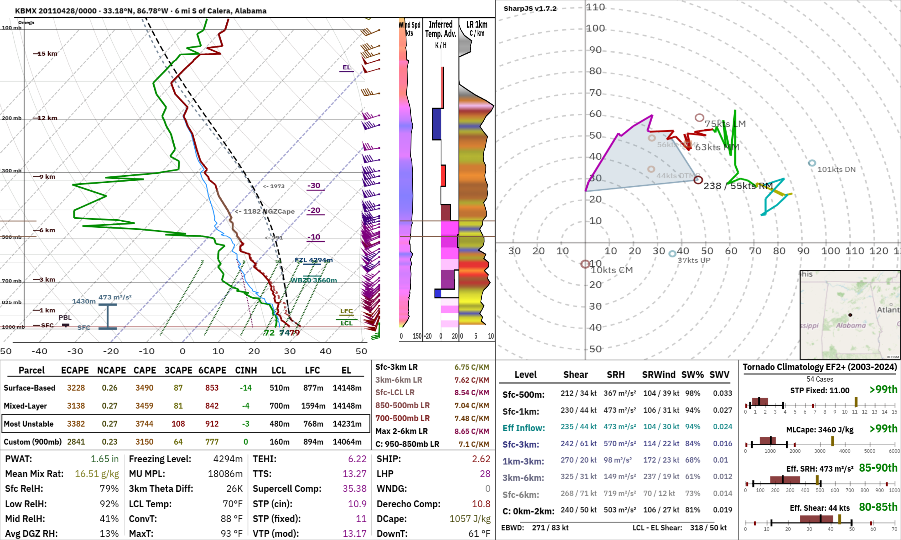

# SharpJS

Interactive Skew-T / hodograph sounding analysis that runs in the browser, plus a headless
calculation core for Node and workers.



**Try it:** <https://diamondflight.github.io/sharpjs/>. Open a sounding file or drop it on the chart, pick a sample, or pull archived data.

This repository is the standalone, open-source SharpJS sounding viewer: no accounts, no servers, no API keys.

## Features

- Skew-T with SB / ML / MU / custom parcels, ECAPE, DCAPE, effective inflow layer, hail and dendritic-growth zones, inferred temperature advection, wind barbs
- Hodograph with Bunkers, Corfidi and Nixon deviant storm motions, custom motions, storm-relative mode, four colour tables, draw-a-front tool
- Parameter tables: SRH / bulk shear / mean and storm-relative wind / EHI by layer, STP (fixed and effective), SCP, SHIP, DCAPE, PWAT, and fire, winter and fog indices
- Side panels: height graphs, CONUS tornado climatology percentiles (EF0+ / EF2+), winter precipitation-type stats
- Presets for tornado, severe/MCS, dryline, elevated, winter, fire and fog/ambient. They are picked automatically per sounding, and any of them can be pinned
- Edit the sounding: drag points on the Skew-T or hodograph, edit the level table, change the surface temperature, dewpoint or wind
- Comparison overlays, averaging several soundings, NEXRAD VAD wind profiles (VWP)
- 3D hodographs with a storm-relative / clean toggle for the viewing angle and motion reference
- Units: default (kt / °C), metric or imperial
- Theme: dark mode by default, with a saved light-mode option
- Independent visibility controls for Skew-T overlays and hodograph components
- Export SHARPpy text, SharpJS text (with omega) or CM1 `input_sounding`, plus a 2000 × 1200 PNG
- **Settings are remembered** in the browser (localStorage, with a cookie fallback, or your own storage). They're versioned, so updates never reset them
- Works on phones (stacked layout)

## Input formats

| Format | How SharpJS recognises it |
| --- | --- |
| SHARPpy / SharpJS text (`%TITLE% … %RAW% … %END%`) | `%RAW%` block; 6 columns, or 7 with omega |
| BUFKIT model files | `STID`, `STNM`, `STIM`; column order read from `SNPARM`, any forecast hour |
| CM1 `input_sounding` | numbers only |
| Chaser Archive JSON | `"level"`, `"hght"`, `"temp"`, … arrays |
| NEXRAD Level III VWP (product 48, `NVW`) | binary |
| Arrays in memory | `fromArrays({ pressure, temperature, dewpoint or relativeHumidity, wind… })` |

## Use it

### 1. The standalone site

```sh
git clone https://github.com/diamondflight/sharpjs.git
cd sharpjs
npm install
npm run dev        # http://localhost:5173
npm run build      # static site in dist/ (deployable anywhere, e.g. GitHub Pages)
```

The **Archive Data** section loads observed soundings from the
[Iowa Environmental Mesonet](https://mesonet.agron.iastate.edu/archive/raob/) RAOB archive. It also loads model
BUFKIT files from the [IEM BUFKIT archive](https://mtarchive.geol.iastate.edu/) and the latest NEXRAD VAD wind
profiles from [Unidata's NEXRAD Level III bucket](https://registry.opendata.aws/noaa-nexrad/), plus archived
ACARS reports from [OU's sounding archive](https://sharp.weather.ou.edu/soundings/acars/). Recent additions include
six-hour ACARS archive browsing with an airport coverage map, a radar-site picker for VWP loads, and a 3D
hodograph mode with a storm-relative / clean toggle. ACARS and VWP archives can be browsed with a UTC time
slider. The ACARS map marks airports with reports in the selected six-hour window; the VWP map shows
WSR-88D radar locations and loading verifies archive availability for the selected radar. IEM and Unidata
provide browser-accessible public endpoints; OU's ACARS endpoint requires same-origin hosting or a
CORS-enabled proxy. Fetch on demand, not on a timer.

#### Load a Sounding File from any URL

Pass a BUFKIT file URL as `fileLocation`; SharpJS detects and parses the format automatically. For
example, this RAP forecast is available from the Iowa State archive:

```js
SharpJS('#chart', {
  fileLocation: 'https://mtarchive.geol.iastate.edu/2026/11/11/bufkit/13/rap/rap_kdsm.buf',
});
```

Use the corresponding BUFKIT URL for another model, station, or forecast time. The remote host must
allow browser CORS requests from your page.

### 2. In your own page: one function call

```js
import { SharpJS } from 'sharpjs';

SharpJS('#chart', { sounding: text });       // draw
SharpJS('#chart', { sounding: nextText });   // same element again → updates in place
```

That's the whole integration. SharpJS builds the chart and the controls panel, wires up the mouse and keyboard
tools, remembers the reader's settings, accepts dropped files and handles export. `sounding` can be text in any
format above, a parsed sounding, or arrays:

To let SharpJS download and display a text sounding from another site, pass its URL as `fileLocation` instead.
The host must allow browser CORS requests from your page. See [the remote-file example](./examples/file-location.html).

```js
SharpJS('#chart', { fileLocation: 'https://data.example.com/soundings/latest.txt' });
```

```js
SharpJS('#chart', {
  sounding: {
    pressure: p, height: z, temperature: t, relativeHumidity: rh, u, v, omega,
    units: { temperature: 'K', windSpeed: 'm/s' },
    title: 'GFS 2026-05-01 12Z F024',
    location: { lat: 35.2, lon: -97.4 },
    isModel: true,                       // gridded data: don't thin the hodograph
  },
  soundingKey: 'gfs|35.2|-97.4|2026050112', // same key = same place, new time: keep parcel/motion choices
  controls: false,                         // you have your own UI
  brandLabel: 'example.com',               // chart credit: "example.com - powered by SharpJS v1.7"
  persist: myServerAdapter,                // or 'auto' | 'local' | 'cookie' | false
  onChange: (state) => updateMyUi(state),
});
```

<details>
<summary><strong>All props</strong></summary>

| Prop | Default | |
| --- | --- | --- |
| `sounding` | – | Text, parsed sounding or arrays. `null` clears the chart. |
| `fileLocation` | `null` | Fetch and load a CORS-accessible text sounding URL. Used only when `sounding` is not provided. |
| `soundingKey` | – | Same key as the previous sounding keeps parcel / storm-motion choices (time scrubbing). |
| `title`, `location` | – | Override the title; attach `{ lat, lon }` (enables the tornado climatology panel and adds coordinates with N/S/E/W suffixes followed by the nearest mapped town and whole-mile distance). |
| `comparisons` | `[]` | `[{ sounding, color?, label?, visible? }]` overlays. |
| `vwp` | – | A VWP sounding (`buildVwpSounding`, `fetchNexradVwp`) or raw NVW bytes. `null` returns to the sounding. |
| `mapImage` | – | Any `CanvasImageSource`, drawn in the hodograph corner (e.g. a map around the site). |
| `settings` | – | Settings to apply over what the reader saved. |
| `defaultSettings` | – | Your defaults, under what the reader saved. |
| `persist` | `'auto'` | `'auto'` (localStorage, else cookie) · `'local'` · `'cookie'` · `false` · a custom adapter. |
| `storageKey` | `'sharpjs:settings'` | Storage key / cookie name. |
| `controls` | `true` | Built-in controls panel. |
| `sources` | – | Data loaders for the Archive section, e.g. `import * as sources from 'sharpjs/sources'`. |
| `brandLabel`, `savedBy`, `filePrefix` | – | Branding on the chart, the "Saved by:" export line, file names. |
| `fileDrop` | `true` | Drop files on the chart to load them (Shift+drop adds comparisons). |
| `injectStyles` | `true` | Add the stylesheet automatically (set `false` to ship your own). |
| `onChange`, `onSettingsChange`, `onLoad`, `onError` | – | Callbacks (also available through `handle.on(event, fn)`). |

</details>

When the built-in Archive controls are given `import * as sources from 'sharpjs/sources'`, loading a
BUFKIT run adds a UTC time slider for that file's hourly forecasts; forecast-hour gaps are disabled.
The ACARS controls list and load all reports in the inclusive six-hour window ending at the selected UTC
hour, with an optional station filter and a coverage map. The VWP map selects a WSR-88D radar; the VWP
archive controls load every available volume for that radar in the inclusive six-hour lookback (archive data
from 2020 onward). The slider stays within the chart display width, uses
UTC labels, and docks above the controls on narrow screens; it hides while the controls fill the
viewport rather than covering them.

The OU ACARS archive does not currently return CORS headers. Its default direct URL therefore requires
the app to be served from the archive's origin. For a different origin, configure `controls.acarsBaseUrl`
to a CORS-enabled proxy/mirror that preserves the archive's year/month/day/hour directory listings and
text files, or provide custom `listAcarsArchive` / `fetchAcarsArchive` callbacks through `sources`. For the
standalone Vite app, set `VITE_ACARS_BASE_URL` at build time; embedded charts can pass
`controls: { acarsBaseUrl: 'https://your-proxy.example/acars' }`.

<details>
<summary><strong>The returned handle</strong></summary>

`SharpJS()` returns the same handle every time for a given element (`SharpJS.get(el)` finds it later):

```js
const chart = SharpJS('#chart', { sounding });
chart.load(text, { location: { lat, lon } });   // or chart.update({ sounding: text })
chart.compare([textA, { sounding: textB, color: 'orange', label: 'NAM' }]);
chart.average([text1, text2, text3]);
chart.setVwp(nvwBytes);                         // chart.setVwp(null) to go back
chart.analysis();                               // headless numbers for what is on screen
chart.exportText('SharpJS');                    // { text, filename }
await chart.screenshot({ scale: 2 });           // PNG data URL
chart.getSettings(); chart.setSettings({ units: 'metric' }); chart.resetSettings();
chart.on('change', (state) => …);
chart.destroy();
```

`chart.engine` exposes the lower-level chart engine (parcel and storm-motion selection, presets, surface edits,
custom layers…) for hosts that build their own controls. See `src/index.d.ts`.

</details>

Several charts can live on one page; each `SharpJS()` call is independent.

### 3. Headless: let SharpJS do the math

```js
import { parseSounding, analyze } from 'sharpjs/core';   // no DOM needed

const a = analyze(parseSounding(text), { parcel: 'ML', motion: 'RM' });
a.parcels.ML.cape;                       // 2554
a.kinematics.layers['0-1km'].srh;        // 270
a.stormMotion.RM;                        // { direction: 233, speed: 27.6 }
a.effectiveInflow.srh;                   // 293
a.indices.stpEffective;                  // 2.9
```

`analyze()` runs the same functions the chart draws with, so the numbers always match what is on screen. Try
`node examples/analyze.mjs path/to/sounding.txt`. The raw calculation functions (`LiftParcel`, `GetSRH`, `GetBM`,
`wetlift`, …) are in `sharpjs/calc`.

## Settings

Everything a reader changes persists: units, skew, hodograph options, pinned presets, default parcel and storm
motion, export format, which control sections are collapsed, and so on. Only values that differ from the defaults are
stored, inside a versioned payload (`{ v, settings }`), and every value is validated on load. So:

- Metric units display parameter-box temperatures in °C and precipitable water in mm.
- a new SharpJS version adds options without touching anyone's saved settings,
- improving a default reaches everyone who never changed it,
- a renamed option gets a migration step in `src/settings/schema.js` instead of a reset.

The **Display/Graphics** section provides independent Skew-T overlay controls (temperature lines, FZL,
WBZ0, mixing-ratio lines, adiabats, parcel paths, wet-bulb/virtual-temperature traces, layer markers,
and related annotations) and hodograph controls (motion vectors, inflow region, map, 3D display,
height labels, wind-profile thinning, ring spacing, and maximum height). These settings are saved with
the rest of the user's preferences. Ring spacing defaults to 10 kt and the hodograph maximum height
to 12 km. Dark mode is enabled by default; `darkMode: false` selects the light palette.

The display-setting keys are:

- **Skew-T visibility:** `showSkewTTemperatureLines`, `showSkewTFZL`, `showSkewTWBZ0`,
  `showSkewTMixingRatio`, `showSkewTDryAdiabats`, `showSkewTMoistAdiabats`, `showSkewTEL`,
  `showSkewTPBL`, `showSkewTInflowLayer`, `showSkewTWetBulb`, `showSkewTVirtualTemperature`,
  `showSkewTECapeParcel`, `showSkewTDCapeParcel`, `showSkewTLCLLFC`, `showSkewTHeights`,
  `showSkewTParcelPath`.
- **Hodograph visibility:** `showHodographBunkersMotions`, `showHodographCustomMeanMotions`,
  `showHodographCorfidiMotions`, `showHodographDeviantMotions`, `showHodographInflowRegion`,
  `showHodographMap`.
- **Hodograph scale:** `hodographRingSpacing` (`0`, `10`, `20`, or `40` kt),
  `hodographMaxHeight` (`12000`, `18000`, or `24000` m), and `hodographTrimWindProfile`.
- **Theme:** `darkMode`.

Hosts can set these preferences with `settings` or provide under-saved defaults through
`defaultSettings`:

```js
SharpJS('#chart', {
  sounding: text,
  settings: {
    darkMode: false,
    showSkewTTemperatureLines: false,
    showSkewTFZL: false,
    showHodographMap: false,
    hodographRingSpacing: 20,
    hodographMaxHeight: 18000,
  },
});
```

Storage is pluggable. `persist: 'cookie'` keeps settings in a first-party cookie (a few hundred bytes). A site with
accounts can pass its own adapter:

```js
const profileAdapter = {
  kind: 'profile',
  load: () => fetch('/api/me/sharpjs').then((r) => r.json()),
  save: (payload) => fetch('/api/me/sharpjs', { method: 'PUT', body: JSON.stringify(payload) }),
};
SharpJS('#chart', { persist: profileAdapter });
```

The standalone site also remembers the last sounding you opened.

## Development

```sh
npm run dev         # standalone site with hot reload
npm test            # unit tests (node:test): parsers, exports, analysis, settings, sources
npm run test:e2e    # browser tests (Playwright; run `npx playwright install chromium` once)
npm run lint
```

[CONTRIBUTING.md](CONTRIBUTING.md) explains how the code is organised, how to add a setting, and what is planned.

```
src/
  index.js            SharpJS() + everything below
  core.js             headless entry (parsers, analyze, settings)
  analysis.js         analyze(), levelAt()
  viewer/             chart engine, markup, styles, controls panel, the SharpJS() wrapper
  calc/               thermodynamics, parcels, kinematics, ECAPE, composite indices
  io/                 parsers (SHARPpy, CM1, BUFKIT, IEM JSON, VWP, arrays), general functions and exporters
  settings/           schema, store, storage adapters
  sources/            optional public-data loaders (IEM, Unidata)
  data/climo/         tornado climatology tables
app/                  the standalone site
```

## Business Inquiries
For all business or related inquiries, contact the developers through sharpjsteam@gmail.com

## Credits
Thanks to Amelia Urquhart ([@a-urq](https://github.com/a-urq)) for help with the ECAPE parcel calculations. Thanks to Michael Barletta ([@michael-barletta](https://github.com/michael-barletta)) for help with maintenence and porting. Parts of the
thermodynamics follow [SHARPpy](https://github.com/sharppy/SHARPpy). See
[THIRD_PARTY_NOTICES.md](THIRD_PARTY_NOTICES.md) for licences and data credits.

## License

[Custom](LICENSE)
